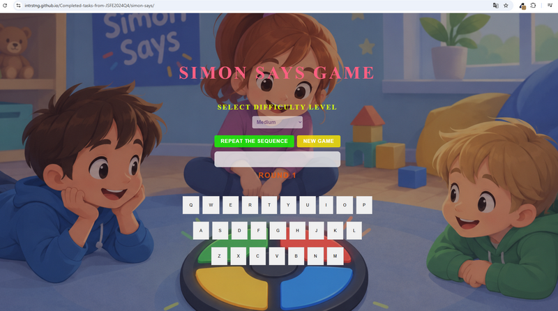

# Simon Says

The task is a variant of the classical **Simon Says** game,
where players must remember and reproduce sequences of keyboard symbols (‘symbols’ refer only to letters and numbers).

## [Deploy](https://intrstng.github.io/Completed-tasks-from-JSFE2024Q4/simon-says/)

## Screenshot
