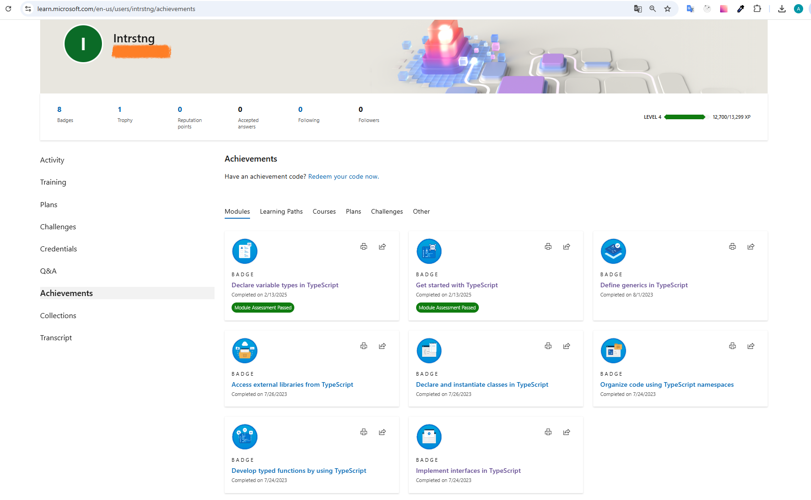

# My TypeScript Journey: Earned Badges 🏆

## Badges Overview

Here is a collection of badges I earned from completing Microsoft Learn's TypeScript modules:

1. **Getting Started with TypeScript**: [Badge](https://learn.microsoft.com/api/achievements/share/en-us/Intrstng/BTG59S7D?sharingId=C3CD0C30A48C6211)
2. **Declare Variable Types in TypeScript**: [Badge](https://learn.microsoft.com/api/achievements/share/en-us/Intrstng/HNRXZFS8?sharingId=C3CD0C30A48C6211)
3. **Implement Interfaces in TypeScript**: [Badge](https://learn.microsoft.com/api/achievements/share/en-us/Intrstng/DS6LBTCJ?sharingId=C3CD0C30A48C6211)
4. **Develop Typed Functions in TypeScript**: [Badge](https://learn.microsoft.com/api/achievements/share/en-us/Intrstng/ZM8HR8F2?sharingId=C3CD0C30A48C6211)
5. **Declare and Instantiate Classes in TypeScript**: [Badge](https://learn.microsoft.com/api/achievements/share/en-us/Intrstng/8FAXJ2PW?sharingId=C3CD0C30A48C6211)
6. **Generics in TypeScript**: [Badge](https://learn.microsoft.com/api/achievements/share/en-us/Intrstng/EKTDLBRP?sharingId=C3CD0C30A48C6211)
7. **Work with External Libraries in TypeScript**: [Badge](https://learn.microsoft.com/api/achievements/share/en-us/Intrstng/2QKPZMDV?sharingId=C3CD0C30A48C6211)
8. **Organize Code with Namespaces in TypeScript**: [Badge](https://learn.microsoft.com/api/achievements/share/en-us/Intrstng/KJLS4DLB?sharingId=C3CD0C30A48C6211)

### Learning path

**Build JavaScript applications using TypeScript**: [Badge](https://learn.microsoft.com/en-us/users/intrstng/achievements/ekje56vp)

## Screenshot:

## Reflections

1. **Getting Started with TypeScript**
TypeScript is a powerful superset of JavaScript that adds static typing to the language.
This module showed me how to get started with the TypeScript compiler. It gave me the basic knowledge of setting up the tsconfig.json file and the standard commands of CLI related to TS.

2. **Declare Variable Types in TypeScript**
This module has greatly enhanced my understanding of TypeScript by emphasizing the importance of static typing.
Understanding variable types and their declarations is crucial for reducing bugs and improving code quality in development work. Using strict type checking can prevent runtime errors by catching type mismatches during compilation.

3. **Implement Interfaces in TypeScript**
In TypeScript, interfaces are a powerful way to define the shape of an object. They allow you to enforce a contract in your code, ensuring that classes or objects adhere to a specific structure.
This module has significantly deepened my understanding of how interfaces can enhance code readability and maintainability. Implementing interfaces is essential for structuring code in a way that promotes reusability and type safety. When developing complex applications, interfaces can help define the structure of data being passed around, ensuring consistency across different components.

4. **Develop Typed Functions in TypeScript**
In TypeScript, developing typed functions allows you to specify the types of parameters and return values, enhancing code clarity and reducing potential errors. Typed functions are crucial in ensuring that the right types are passed to functions, which minimizes bugs and enhances maintainability.
This module has improved my understanding of how typed functions contribute to writing safer and more predictable code. By defining parameter and return types, I learned to catch errors during compilation rather than at runtime.

5. **Declare and Instantiate Classes in TypeScript**
In TypeScript, classes provide a way to encapsulate data and functionality, allowing for object-oriented programming.
This module has enhanced my understanding of how to effectively use classes in TypeScript. I learned about class properties, constructors, and methods, which together provide a clear structure for creating reusable components. Additionally, understanding access modifiers like public, private, and protected has helped me grasp how to control visibility and encapsulate functionality within classes.

6. **Generics in TypeScript**
Generics in TypeScript allow you to create reusable components that can work with any data type while maintaining type safety. 
By using generics, I learned how to create functions and classes that can handle various data types while ensuring type safety.
Generics are essential for building scalable applications, as they allow developers to write more abstract and reusable code.

7. **Work with External Libraries in TypeScript**
This module has enriched my understanding of how to effectively integrate and utilize external libraries within TypeScript projects.
Understanding how to properly import and utilize these libraries ensures that my code remains clean and efficient. It also allows for better collaboration, as team members can rely on consistent and type-safe implementations of shared functionality.

8. **Organize Code with Namespaces in TypeScript**
Namespaces in TypeScript provide a way to group related code, helping to avoid naming collisions and organize larger codebases. They serve as a logical grouping for variables, functions, and classes, making it easier to manage and maintain code.
This module helped me understand how namespaces can help structure code logically. By grouping related functions, I can create a clearer separation of concerns in my application.